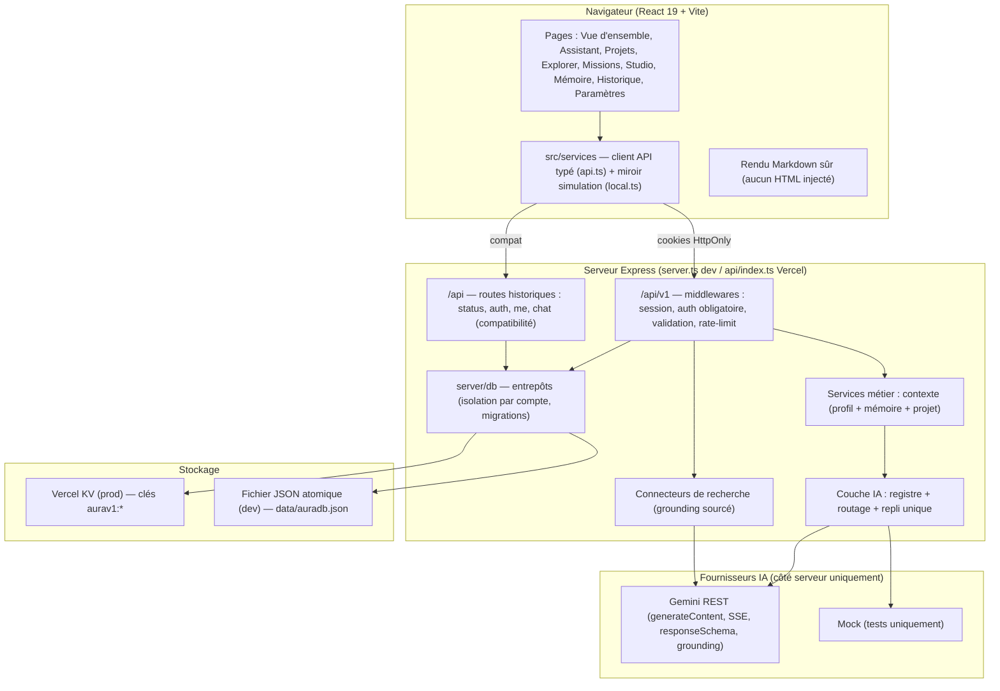
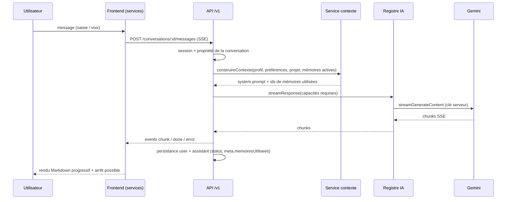

# Architecture cible — AURA Workspace

> **Note (2026-11-06)** : la couche IA décrite ici (fournisseur Gemini
> unique) a été reconstruite en architecture multi-fournisseurs — voir
> [`AI-MULTI-PROVIDER.md`](./AI-MULTI-PROVIDER.md). Le reste du document
> reste valide (persistance, routes, frontend).

> Suite à la [proposition technique](000-proposition-technique.md). État
> implémenté sur la branche `arena/3bf5199b-aura`.

## 1. Vue d'ensemble

## 2. Assistant : contexte et flux

## 3. Modules et dépendances

| Module | Route | Service | Entités | Capacité déclarée |
|---|---|---|---|---|
| Vue d'ensemble | `/app` | agrégation services | conversations, projets, missions, créations | toujours |
| Assistant | `/chat`, `/chat/:id` | conversations + ai | conversations, messages | `assistant.ok` |
| Projets | `/projets`, `/projets/:id` | projets | projets (+ éléments rattachés) | `comptes` |
| Explorer | `/explore` | search | recherches, sources | `recherche.ok` |
| Missions | `/missions` | missions (+ `aide` structuré) | missions, sous-tâches | `comptes` (+ IA pour l'aide) |
| Studio | `/studio` | studio | créations, versions | `studio.ok` |
| Mémoire | `/memoire` | mémoire | mémoires | `comptes` |
| Historique | `/historique` | conversations | conversations | `comptes` |
| Paramètres / AURA Local | `/parametres` | compte + préférences | profil, préférences | `comptes` |

**Règle d'interface (système de capacités)** : le backend expose l'état réel
via `GET /api/v1/capabilities` ; chaque écran affiche les états honnêtes
(indisponible, non configuré) et n'annonce jamais une fonction inexistante.

## 4. Frontend — structure

Migration progressive (décision d'architecture) : les pages restent dans
`src/pages/` (organisation existante conservée), la logique d'accès aux
données a été extraite vers `src/services/` (`api.ts` = client HTTP typé +
`local.ts` = miroir du mode simulation), les briques UI vers
`src/components/ui/` (Markdown sûr, Dialogue accessible, états communs).
Toute la logique métier est hors composants (serveur ou services).

## 5. Décisions justifiées

| Décision | Justification |
|---|---|
| Agrégat JSON par utilisateur + index globaux (plutôt qu'une vraie BDD) | Contrainte Vercel réelle : pas de base SQL disponible sans provisionnement ; le contrat `BaseDeDonnees` est isolé, un pilote SQL peut être branché sans toucher au métier. Tailles plafonnées (3000 messages/compte, 300/fil). |
| Sessions opaques empreintées (sha256), pas de JWT | Révocation immédiate (déconnexion), pas de secret longue durée côté client. |
| Streaming SSE plutôt que WebSocket | Compatible serverless Vercel (30 s), suffisant pour du texte ; l'arrêt utilisateur passe par `AbortController` des deux côtés. |
| Markdown rendu en éléments React (parseur restreint) | Zéro surface XSS par conception, contrairement à `dangerouslySetInnerHTML`. |
| Recherche : connecteur grounding | Sources réelles extraites des métadonnées ; sans moteur, UI indisponible — jamais de liens inventés. |
| Régénération côté serveur (`regenerer: true`) | Pas de faux message utilisateur ; la réponse précédente est remplacée dans l'historique. |
| Un seul répertoire `server/` par couche (db, ai, search, services, v1) | « Proportionné » : pas de couches vides ; l'extension se fait par fichier. |
