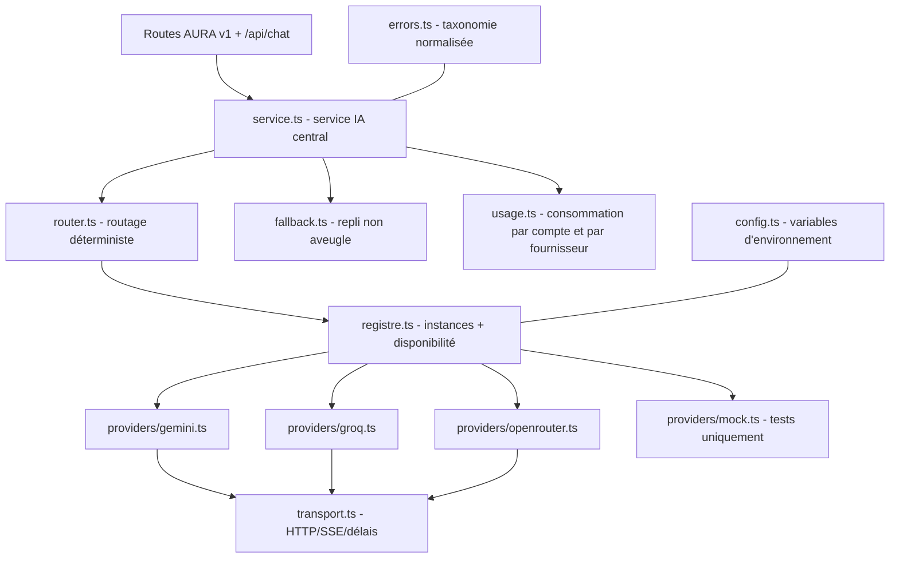

# Architecture IA multi-fournisseurs d'AURA

> **État : clés API non encore configurées.** L'architecture est prête à les
> recevoir ; les appels réels aux fournisseurs restent à valider après ajout
> des clés (voir § « Configuration après la mission »). Tout ce qui a été
> testé sans clé est listé dans § « Tests disponibles ».

## 1. Architecture générale

Les fonctionnalités IA d'AURA (assistant, missions, studio, recherche
sourcée, historique) passent par un **service central unique**. Aucune
route, aucun composant applicatif ne dépend de la syntaxe d'un fournisseur.

Fichiers (dossier `server/ai/`) :

| Composant | Rôle |
|---|---|
| `types.ts` | Contrat commun (`FournisseurAi`), types de requêtes/réponses, capacités |
| `errors.ts` | Erreurs normalisées (`ErreurAi`, `CODES_AI`) + classification (auth, quota, timeout, réseau, validation, contenu, sortie) |
| `config.ts` | Lecture centralisée des variables d'environnement (+ alias historiques) |
| `transport.ts` | HTTP JSON avec délai d'attente, lecture SSE, normalisation des statuts |
| `providers/gemini.ts` | Adaptateur Google Gemini (REST `v1beta`, streaming SSE, `responseSchema`, grounding Google Search, images en entrée) |
| `providers/groq.ts` | Adaptateur Groq (API compatible OpenAI, `json_schema` pour les sorties structurées) |
| `providers/openrouter.ts` | Adaptateur OpenRouter (API compatible OpenAI, catalogue de modèles, `json_object` + schéma en consigne) |
| `providers/openai-compat.ts` | Transport partagé des API compatibles OpenAI (pas de duplication) |
| `providers/mock.ts` | Fournisseur simulé **réservé aux tests**, avec injection de pannes |
| `router.ts` | Politique de routage : tâche → capacités requises/preferables |
| `fallback.ts` | Chaîne de repli : classification, plafond de tentatives, règles de bascule |
| `registre.ts` | Construction des fournisseurs depuis la config, disponibilité, désactivation sur erreur d'authentification |
| `usage.ts` | Suivi de consommation par utilisateur et par fournisseur (événements sans contenu ni secret) |
| `service.ts` | Point d'entrée unique : `generer`, `genererEnStream`, `genererStructure`, `rechercherAvecSources`, `etatIa` |

## 2. Interface commune

Chaque adaptateur implémente `FournisseurAi` :

- `generateResponse(req)` — génération de texte ;
- `streamResponse(req, onChunk, signal)` — streaming, avec **annulation**
  (`AbortSignal`) et conservation du texte partiel en cas d'interruption ;
- `generateStructuredOutput(req)` — sortie JSON validée contre un schéma ;
- `rechercherAvecSources(question, system)` — recherche sourcée réelle
  (capacité `sources` : les URLs proviennent du moteur, jamais du modèle) ;
- `getCapabilities()` — déclaration honnête des capacités (texte, streaming,
  images en entrée, sortie structurée, code, sources, …) ;
- `checkAvailability()` — présence de la clé (aucun appel réseau).

Les messages peuvent porter des images (`MessageAi.images`) ; seuls les
fournisseurs déclarant `imagesEntree` les acceptent — les autres reçoivent
le texte seul.

## 3. Routage (Phase 4)

Déterministe et configuré — jamais « au choix d'un modèle » :

| Type de demande | Routage |
|---|---|
| Conversation générale | Fournisseur principal disponible (texte + streaming) |
| Génération de code | Modèle déclaré compatible code |
| Analyse d'image | Fournisseur compatible entrée image |
| Tâche de raisonnement | Modèle disposant des capacités nécessaires |
| Sortie structurée (missions) | Fournisseur compatible sortie JSON |
| Recherche sourcée | Fournisseur compatible recherche grounding |
| Fournisseur indisponible | Autre fournisseur compatible (selon `AI_FALLBACK_ORDER`) |

Priorités centralisées dans `router.ts` (`POLITIQUE_ROUTAGE`) et dans la
configuration (`AI_DEFAULT_PROVIDER` épinglé en tête de `AI_FALLBACK_ORDER`).
Changer les priorités = changer la configuration, pas le backend.

## 4. Repli intelligent (Phase 5)

1. La nature de l'erreur est identifiée (`errors.ts`) ;
2. seuls des fournisseurs **configurés et capables** sont replis ;
3. `AI_MAX_RETRIES` plafonne les tentatives supplémentaires ;
4. chaque bascule est journalisée (techniquement + événement d'usage `repli`) ;
5. la réponse reçue d'un fournisseur de secours est identique en forme —
   l'expérience utilisateur ne change pas.

Règles strictes :

- **requête invalide / contenu refusé / réponse vide** → aucun repli
  (spécifique à la demande) ;
- **authentification refusée** → jamais de nouvelle tentative sur CE
  fournisseur (désactivation durable jusqu'au prochain redémarrage ou
  changement de configuration), la chaîne bascule sur le suivant (repli,
  pas « réessai ») ;
- **quota / délai dépassé / réseau / serveur** → bascule légitime ;
- **streaming** : si un premier fragment a déjà été émis vers le client,
  jamais de bascule silencieuse — l'erreur est remontée telle quelle ;
  tant qu'aucun fragment n'est émis, la bascule reste possible.

## 5. Variables d'environnement

Voir `.env.example` (valeurs vides, aucun secret réel). Résumé :

| Variable | Rôle | Défaut |
|---|---|---|
| `GEMINI_API_KEY` | Clé Google Gemini | — |
| `GROQ_API_KEY` | Clé Groq | — |
| `OPENROUTER_API_KEY` | Clé OpenRouter | — |
| `AI_DEFAULT_PROVIDER` | `auto` \| `gemini` \| `groq` \| `openrouter` \| `mock` (tests) | `auto` |
| `AI_FALLBACK_ORDER` | Ordre de repli | `gemini,groq,openrouter` |
| `AI_MAX_RETRIES` | Tentatives supplémentaires après le 1er fournisseur | `2` |
| `AI_REQUEST_TIMEOUT_MS` | Délai max par requête fournisseur | `60000` |
| `GEMINI_MODEL` / `GROQ_MODEL` / `OPENROUTER_MODEL` | Modèles utilisés | `gemini-3.8-flash` / `llama-3.3-70b-versatile` / `openai/gpt-4o-mini` |
| `GEMINI_SEARCH_MODEL` | Modèle de recherche sourcée | = `GEMINI_MODEL` |
| `GEMINI_API_BASE` / `GROQ_API_BASE` / `OPENROUTER_API_BASE` | Points d'entrée (tests/proxys) | URLs officielles |

Alias historiques acceptés (migration progressive) : `AURA_GEMINI_API_KEY`,
`AURA_MODELE`, `AURA_MODELE_URL`, `AURA_AI_PROVIDER`, `AURA_MODELE_RECHERCHE`.

**Local** : copier `.env.example` en `.env` (exclu par `.gitignore`).
**Vercel** : Project Settings → Environment Variables — renseigner les mêmes
noms sur Production/Preview. Les clés ne doivent jamais porter le préfixe
`VITE_` (elles seraient alors embarquées dans le bundle navigateur).

## 6. Comportement sans clé

L'application reste fonctionnelle (comptes, projets, persistance,
navigation) ; le système IA :

- ne simule **aucune** réponse et ne retourne rien de codé en dur ;
- renvoie une erreur structurée (`code: 'aucun-fournisseur'`, statut 503)
  affichée honnêtement dans l'interface ;
- journalise côté serveur quel fournisseur manque de configuration
  (`[ia] fournisseur 'x' non configuré`) ;
- n'expose **aucun nom de fournisseur ni de modèle** dans l'API ni dans
  l'interface (les noms servent uniquement aux logs techniques et à
  l'usage interne).

## 7. Sécurité

- clés lues uniquement côté serveur (`config.ts`), jamais journalisées,
  jamais dans les messages d'erreur (testé) ;
- routes IA derrière l'authentification + rate limiting existants ;
- validation des entrées (longueurs, rôles) avant appel fournisseur ;
- délais d'attente (`AI_REQUEST_TIMEOUT_MS`) et interruption utilisateur ;
- isolation par compte : l'usage est stocké dans l'agrégat utilisateur ;
- les données transmises aux fournisseurs = le contenu des prompts
  utilisateur (transparence : mention affichée dans l'interface) ;
- **BYOK** (clés par utilisateur) : non implémenté volontairement ;
  l'emplacement prévu est `config.ts` (lecture de clé par compte) —
  l'architecture reste extensible pour l'accueillir sans refonte.

## 8. Configuration des clés après la mission

1. Obtenir les clés : Google AI Studio, console Groq, clés OpenRouter ;
2. **Local** : `.env` → `GEMINI_API_KEY=` / `GROQ_API_KEY=` / `OPENROUTER_API_KEY=` ;
3. **Vercel** : Settings → Environment Variables (mêmes noms), redéployer ;
4. vérifier : `GET /api/v1/capabilities` → `assistant.ok = true` ;
5. tester un message assistant, une aide-mission, une création studio,
   une recherche Explorer.

Aucune modification de code n'est nécessaire. Pour changer de modèle
prioritaire : `AI_DEFAULT_PROVIDER` + `AI_FALLBACK_ORDER`, ou `*_MODEL`.

## 9. Ajouter un quatrième fournisseur

1. Créer `server/ai/providers/monfournisseur.ts` : implémenter
   `FournisseurAi` (ou étendre `FournisseurCompatOpenAi` si l'API est
   compatible OpenAI) avec ses capacités réelles ;
2. ajouter sa configuration dans `config.ts` (clé, base, modèle) ;
3. l'enregistrer dans `construire()` (`registre.ts`) et dans
   `ordreFournisseurs()` (défaut) ;
4. étendre `IdFournisseur` ;
5. ajouter ses tests dans `tests/ai.test.ts` (stub HTTP local) ;
6. `.env.example` + ce document.

Aucun composant métier n'est modifié.

## 10. Tests disponibles

- `npm test` — 49 tests : contrat commun des 4 fournisseurs, détection des
  clés absentes, routage déterministe, règles de fallback (quota, auth,
  timeout, réseau, validation, streaming interrompu), erreurs normalisées,
  non-exposition des clés et des noms internes, suivi d'usage, + la
  non-régression des fonctionnalités (comptes, conversations, projets,
  missions, mémoire, studio, suppression de compte) ;
- `tests/parcours-acceptation.cjs` — parcours de bout en bout (navigateur) ;
- `tests/verif-005.cjs` — suppression de compte + export PDF.

**Testé** : toute la chaîne avec fournisseurs simulés (stubs HTTP aux
formats d'API réels Gemini et OpenAI-compatible), le mode sans clé, les
règles de repli, les contrats de streaming.
**Restant à vérifier avec les clés** : les appels réels aux trois
fournisseurs (génération, streaming, sorties structurées, grounding), les
modèles par défaut choisis (`GEMINI_MODEL`, `GROQ_MODEL`,
`OPENROUTER_MODEL` — ajustables), les quotas et limites réels.

## 11. Limites connues

- la recherche sourcée dépend du grounding Google (capacité `sources` :
  seul Gemini l'implémente actuellement) — sans clé Gemini, Explorer
  déclare honnêtement la recherche indisponible ;
- la génération d'images et les pièces jointes restent indisponibles
  (stockage objet non configuré) ;
- `OPENROUTER_MODEL` par défaut (`openai/gpt-4o-mini`) est un choix
  conservateur et multimodal : l'entrée image est déclarée `false` tant
  qu'un modèle vision n'est pas configuré explicitement (constante de
  capacités de `providers/openrouter.ts`) ;
- les capacités déclarées sont celles des modèles par défaut ; un modèle
  surchargé par `*_MODEL` peut différer (documenté dans chaque adaptateur).
