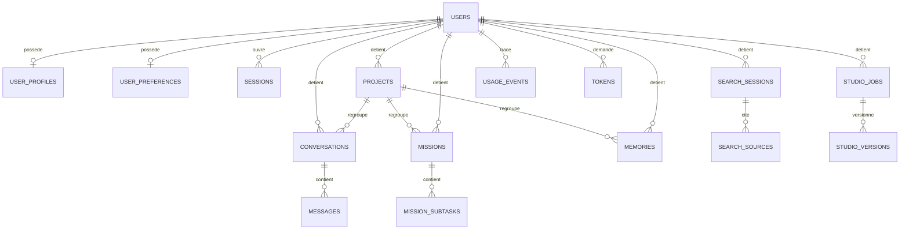

# Modèle de données — AURA

## 1. Modèle logique

Entités (détail des champs : `server/db/types.ts`, source de vérité exécutable) :

- **Users** `id, email (unique), nom, hash, sel, cree` — jamais de mot de passe en clair (scrypt + sel par utilisateur).
- **UserProfiles** `pays, region, languePrincipale, languesSecondaires[], devise, fuseau, unites, domaine` — profil contextuel AURA Local.
- **UserPreferences** `tonReponse, utiliserMemoire, langueReponse`.
- **Sessions** `id (empreinte sha256 du jeton), userId, expire, cree, agent?, derniereActivite?` — le jeton brut ne quitte jamais le cookie HttpOnly ; l'agent et la dernière activité servent uniquement à décrire la session à son propriétaire.
- **Tokens** `id (empreinte sha256 du jeton), type(verification|reinitialisation), userId, cree, expire, utiliseLe, empreinteEmail` — jetons à usage unique de vérification d'adresse et de réinitialisation. La valeur envoyée par e-mail n'existe nulle part en base.
- **Users** porte aussi `emailVerifie?`, `emailVerifieLe?` — vérification non bloquante : absent = non confirmé.
- **Conversations** `id, userId, projectId?, titre, archive, cree, maj`.
- **Messages** `id, conversationId, userId, role, contenu, statut(envoye|genere|interrompu|erreur), cree, meta{modele, erreur, memoiresUtilisees[]}`.
- **Projects** `id, userId, nom, description, objectif, categorie, statut(actif|archive), instructions, cree, maj`.
- **Missions** `id, userId, projectId?, titre, description, priorite, statut, echeance, ordre, notes, cree, maj`.
- **MissionSubtasks** `id, missionId, titre, fait`.
- **Memories** `id, userId, projectId?, type(preference|contexte_personnel|preference_reponse|professionnel|instruction_projet|temporaire), contenu, actif, cree, maj`.
- **SearchSessions** `id, userId, projectId?, requete, synthese, statut, erreur, cree` ; **SearchSources** `id, rechercheId, titre, url, extrait, dateSource` — URLs issues du moteur uniquement.
- **StudioJobs** `id, userId, projectId?, type, titre, instruction, statut, erreur, cree, maj` ; **StudioVersions** `id, jobId, numero, contenu, note, cree` — historique immuable des versions.
- **UsageEvents** `id, userId, genre, cree, meta` — télémétrie technique sans contenu privé (limitée à 500/compte).

## 2. Projection physique

Pilotes interchangeables derrière `BaseDeDonnees` (`server/db/base.ts`) :

| Pilote | Usage | Clés |
|---|---|---|
| `kv` (Vercel KV / Upstash REST) | production | `aurav1:compte:<userId>`, `aurav1:email:<email>` → userId, `aurav1:session:<sha256>`, `aurav1:jeton:<sha256>`, `aurav1:jeton-actif:<userId>:<type>`, `aurav1:jeton-verrou:<sha256>`, `aurav1:data:<userId>`, `aurav1:rl:<portee>:<id>` |
| `fichier` (JSON atomique tmp+rename) | dev / auto-hébergement | même espace de clés dans `data/auradb.json` |
| `indisponible` | Vercel sans KV | refus `503` honnête, jamais de faux stockage |

Jetons — trois clés, jamais le jeton brut :

| Clé | Contenu | Durée de vie |
|---|---|---|
| `aurav1:jeton:<sha256>` | enregistrement complet du jeton (empreinte d'adresse incluse) | 24 h (vérification) / 30 min (réinitialisation), posée à l'écriture |
| `aurav1:jeton-actif:<userId>:<type>` | empreinte du dernier jeton émis pour ce compte | même durée : un nouvel envoi invalide le précédent |
| `aurav1:jeton-verrou:<sha256>` | verrou de consommation (`SET … NX EX 120`) | 120 s — c'est lui qui rend l'usage unique atomique entre instances |

`aurav1:data:<userId>` est l'agrégat utilisateur (conversations, messages,
projets, missions, mémoires, recherches, sources, créations, événements),
avec `schemaVersion` et migrations à la lecture (`migrerDonnees`).

**Migration des comptes existants** : l'ancien dépôt unique
(`data/comptes.json` / KV `aura:comptes`) est importé automatiquement
(`migrerAncienDepot`) — les comptes et sessions existants continuent de
fonctionner sans réinitialisation.

## 3. Contraintes et limites assumées

- **Isolation** : chaque entrepôt est instancié avec un `userId` ; aucune
  requête ne peut lire un autre périmètre (vérifié par tests).
- **Plafonds** : 3000 messages/compte (élagage du plus ancien), 300/fil,
  500 événements, 300 créations, 200 recherches — au-delà, élagage silencieux
  des plus anciens éléments (documenté, jamais de perte de compte).
- **Valeur KV limitée** (~1 Mo Upstash) : les plafonds ci-dessus maintiennent
  l'agrégat sous ce seuil ; un pilote SQL est le prochain palier si le volume
  réel l'exige (interface déjà prête).
- **Suppression cohérente** : conversation → messages ; projet → détachement
  (pas de cascade destructive sur le travail de l'utilisateur) ;
  compte → (à implémenter : suppression de compte, voir prochaines étapes).
- **Migrations versionnées** : `SCHEMA_VERSION` + `migrerDonnees` ; tout
  ancien schéma est complété à la lecture (tests `entrepots.test.ts`).
